<!-- Banner pixel glints are an original SVG animation, inspired by pixelfx (MIT) by Patch and Hugo Duprez: https://github.com/patch-gg/pixelfx -->
<a href="https://sergushkin.com">
<picture>
  <source media="(prefers-color-scheme: dark)" srcset="assets/banner-dark.svg">
  
</picture>
</a>

I design and build interfaces for software that acts on its own: an AI agent does part of the work, and a person stays in charge.
14 years on complex systems: ERP, B2B SaaS, AI workflows. When a question is about latency, autonomy or trust, a static mock can't answer it, so I build the answer.

**Open to roles.** Design engineer or principal product designer, permanent, based in Munich. [About and CV](https://sergushkin.com/about)

<!-- this-week: edit the next line by hand. No GitHub Action. See docs/PROJECT.md. -->

**This week.** I shipped the [Redline Supply](https://redline-supply-seven.vercel.app) prototype, gave [agentic-ui](https://agentic-ui-docs.vercel.app/changelog) thirteen n8n-style pieces for showing a running agent, made a comment in [Agentic UX Lab](https://agentic-ux-lab.vercel.app) open the exact moment in a session, and put together a CV page template for the site. I want the agent UI to show what the agent is doing and let you step in, not just a chat box.

### Selected work

<a href="https://projects-gallery-pi.vercel.app"><b>Browse all prototypes by topic</b></a>

<table>
  <tr>
    <td width="50%" valign="top">
      <a href="https://world-parts.vercel.app">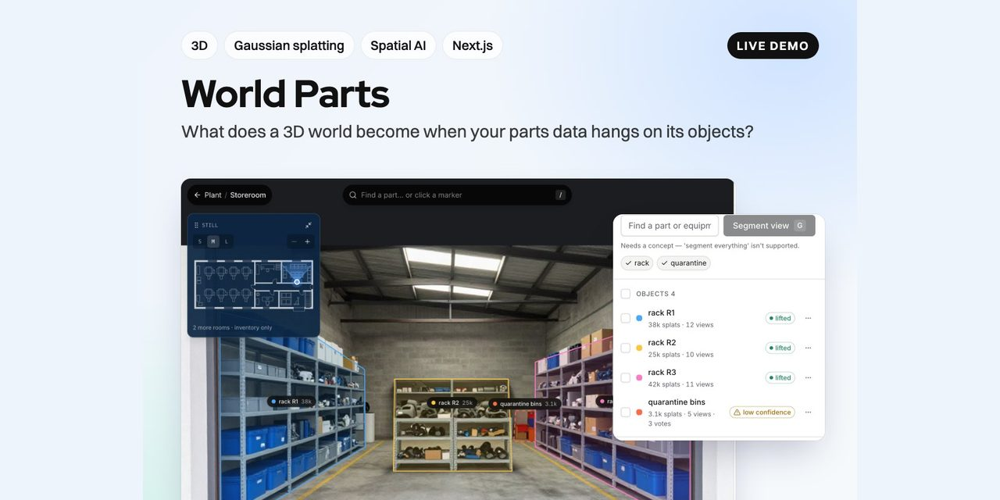</a>
       <b>World Parts</b> · <a href="https://world-parts.vercel.app">Live</a> · <a href="https://github.com/sergushkincom/world-parts">Repo</a>
       

Watch it move

      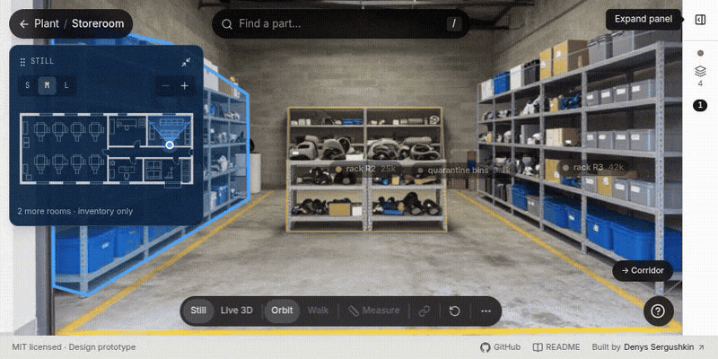
      

    </td>
    <td width="50%" valign="top">
      <a href="https://agentic-ui-docs.vercel.app">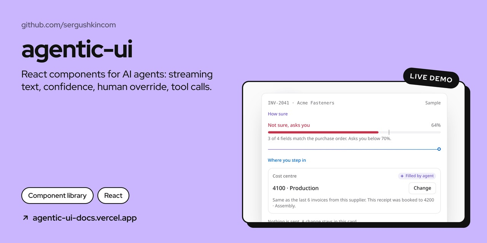</a>
       <b>agentic-ui</b> · <a href="https://agentic-ui-docs.vercel.app">Live</a> · <a href="https://github.com/sergushkincom/agentic-ui">Repo</a>
       

Watch it move

      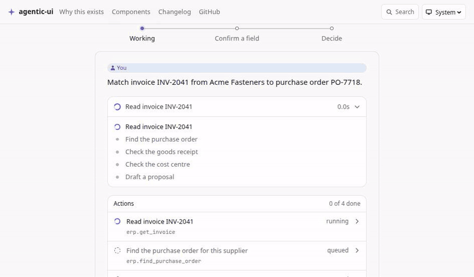
      

    </td>
  </tr>
  <tr>
    <td width="50%" valign="top">
      <a href="https://redline-supply-seven.vercel.app/requests/cmp_rohs/review">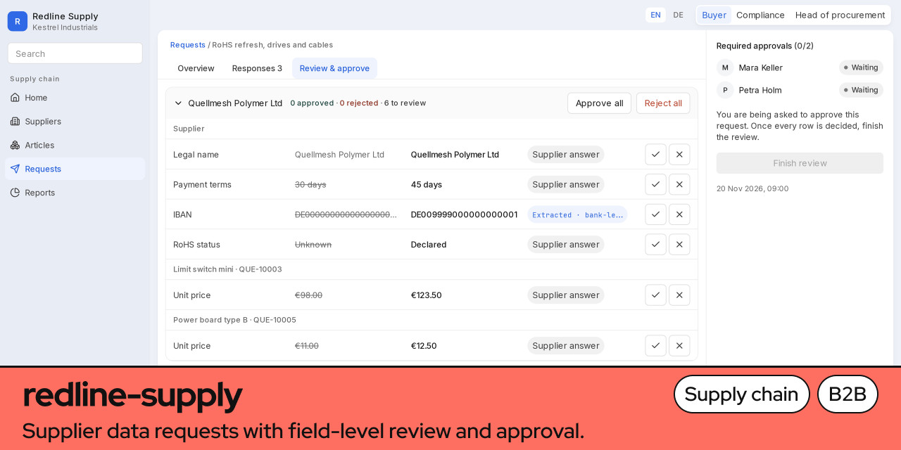</a>
       <b>Redline Supply</b> · <a href="https://redline-supply-seven.vercel.app/requests/cmp_rohs/review">Live</a> · <a href="https://github.com/sergushkincom/redline-supply">Repo</a>
       

Watch it move

      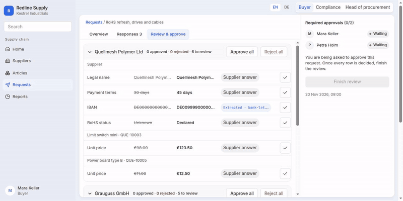
      

    </td>
    <td width="50%" valign="top">
      <a href="https://battery-because.vercel.app/assets/lechfeld-1/why?role=owner&amp;portfolio=kestrel&amp;period=7d&amp;loc=en-GB&amp;date=2026-11-18">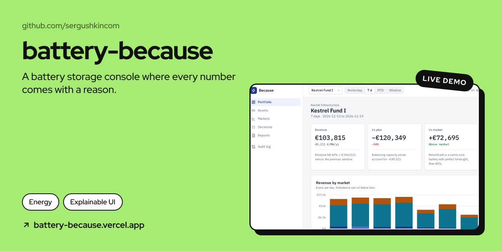</a>
       <b>Because</b> · <a href="https://battery-because.vercel.app/assets/lechfeld-1/why?role=owner&amp;portfolio=kestrel&amp;period=7d&amp;loc=en-GB&amp;date=2026-11-18">Live</a> · <a href="https://github.com/sergushkincom/battery-because">Repo</a>
       

Watch it move

      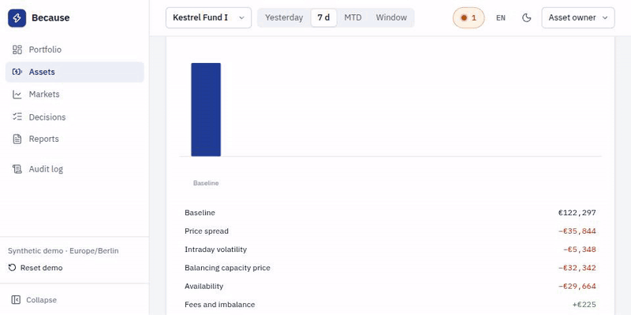
      

    </td>
  </tr>
  <tr>
    <td width="50%" valign="top">
      <a href="https://denys-workflow-canvas.vercel.app/experiments/workflow-canvas">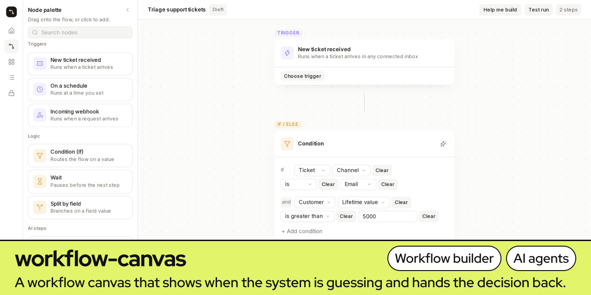</a>
       <b>Workflow canvas</b> · <a href="https://denys-workflow-canvas.vercel.app/experiments/workflow-canvas">Live</a> · <a href="https://github.com/sergushkincom/workflow-canvas">Repo</a>
       

Watch it move

      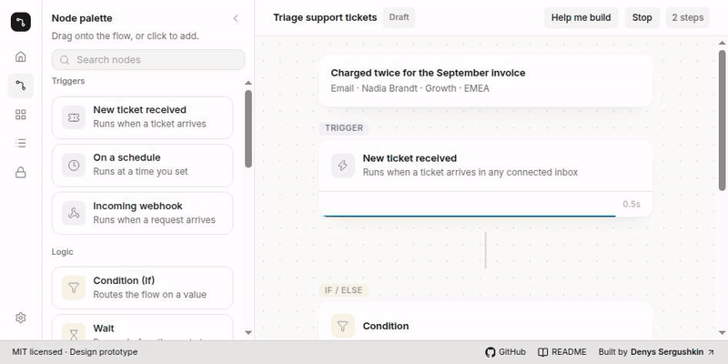
      

    </td>
    <td width="50%" valign="top">
      <a href="https://denys-knowledge-atlas.vercel.app">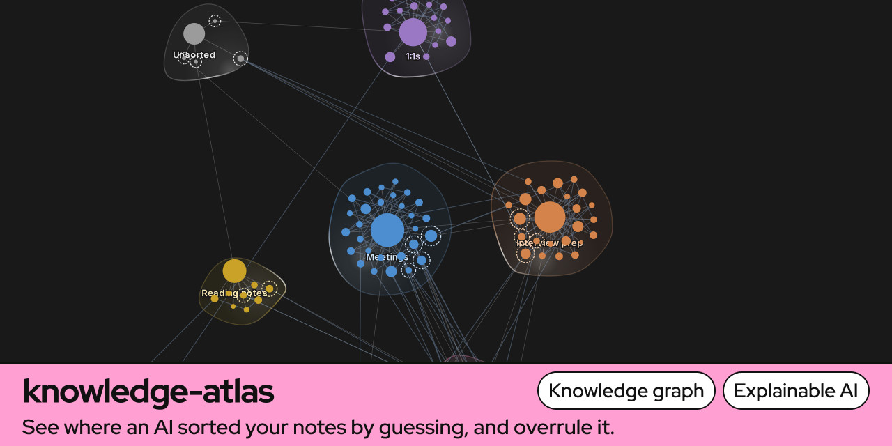</a>
       <b>Knowledge Atlas</b> · <a href="https://denys-knowledge-atlas.vercel.app">Live</a> · <a href="https://github.com/sergushkincom/knowledge-atlas">Repo</a>
       

Watch it move

      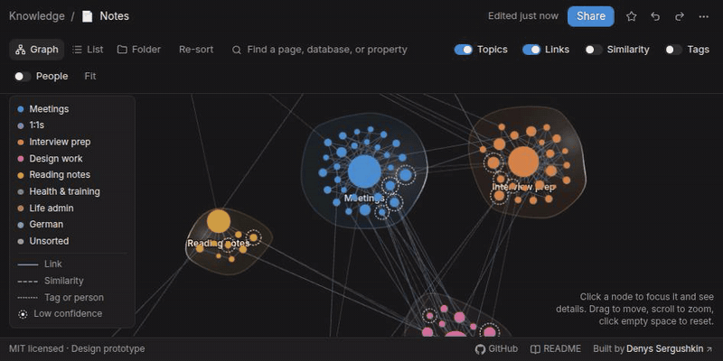
      

    </td>
  </tr>
</table>

### Recently shipped

<!-- SHIPPED:START -->
- [Profile: one gallery, live demos grouped by topic](https://github.com/sergushkincom/sergushkincom/pull/17) · [sergushkincom](https://github.com/sergushkincom/sergushkincom) · 21 Nov 2026
- [Add live demo link](https://github.com/sergushkincom/redline-supply/pull/2) · [redline-supply](https://github.com/sergushkincom/redline-supply) · 21 Nov 2026
- [Add a changelog page and New badges](https://github.com/sergushkincom/agentic-ui/pull/35) · [agentic-ui](https://github.com/sergushkincom/agentic-ui) · 21 Nov 2026
- [Add step inspector, expression field, and pinned output](https://github.com/sergushkincom/agentic-ui/pull/57) · [agentic-ui](https://github.com/sergushkincom/agentic-ui) · 21 Nov 2026
- [Add wait, connection, and harness components](https://github.com/sergushkincom/agentic-ui/pull/56) · [agentic-ui](https://github.com/sergushkincom/agentic-ui) · 21 Nov 2026

Live demos: [redline-supply](https://redline-supply-seven.vercel.app) · [agentic-ui](https://agentic-ui-docs.vercel.app)
<!-- SHIPPED:END -->

### By topic

The whole list. Open a theme. A live link is here only when that demo is up.

<b>Agentic UI &amp; AI agents</b>

<table>
  <tr>
    <td width="24%" valign="top"><b>agentic-ui</b></td>
    <td valign="top">What the agent is doing, how sure it is, and where a person can take the work back.</td>
    <td width="22%" valign="top" align="right"><a href="https://agentic-ui-docs.vercel.app">Live</a> · <a href="https://github.com/sergushkincom/agentic-ui">Repo</a></td>
  </tr>
  <tr>
    <td width="24%" valign="top"><b>Because</b></td>
    <td valign="top">A battery console where every number comes with the reason.</td>
    <td width="22%" valign="top" align="right"><a href="https://battery-because.vercel.app">Live</a> · <a href="https://github.com/sergushkincom/battery-because">Repo</a></td>
  </tr>
  <tr>
    <td width="24%" valign="top"><b>Workflow canvas</b></td>
    <td valign="top">A ticket flow that stops and asks when it is not sure.</td>
    <td width="22%" valign="top" align="right"><a href="https://denys-workflow-canvas.vercel.app/experiments/workflow-canvas">Live</a> · <a href="https://github.com/sergushkincom/workflow-canvas">Repo</a></td>
  </tr>
  <tr>
    <td width="24%" valign="top"><b>Knowledge Atlas</b></td>
    <td valign="top">Notes an AI grouped, with the low-confidence ones marked so you can overrule them.</td>
    <td width="22%" valign="top" align="right"><a href="https://denys-knowledge-atlas.vercel.app">Live</a> · <a href="https://github.com/sergushkincom/knowledge-atlas">Repo</a></td>
  </tr>
  <tr>
    <td width="24%" valign="top"><b>Permission rings</b></td>
    <td valign="top">How far a scheduling agent may go with other people's time.</td>
    <td width="22%" valign="top" align="right"><a href="https://permission-rings.vercel.app">Live</a> · <a href="https://github.com/sergushkincom/permission-rings">Repo</a></td>
  </tr>
  <tr>
    <td width="24%" valign="top"><b>Agentic UX Lab</b></td>
    <td valign="top">Interaction experiments for AI software, built in code.</td>
    <td width="22%" valign="top" align="right"><a href="https://agentic-ux-lab.vercel.app">Live</a> · <a href="https://github.com/sergushkincom/agentic-ux-lab">Repo</a></td>
  </tr>
</table>

<b>3D &amp; spatial</b>

<table>
  <tr>
    <td width="24%" valign="top"><b>World Parts</b></td>
    <td valign="top">Find a spare part in a segmented 3D plant, room by room.</td>
    <td width="22%" valign="top" align="right"><a href="https://world-parts.vercel.app">Live</a> · <a href="https://github.com/sergushkincom/world-parts">Repo</a></td>
  </tr>
</table>

<b>ERP &amp; B2B tools</b>

<table>
  <tr>
    <td width="24%" valign="top"><b>Redline Supply</b></td>
    <td valign="top">Ask suppliers once, then approve every change with the old value, the new value, and the source.</td>
    <td width="22%" valign="top" align="right"><a href="https://redline-supply-seven.vercel.app">Live</a> · <a href="https://github.com/sergushkincom/redline-supply">Repo</a></td>
  </tr>
  <tr>
    <td width="24%" valign="top"><b>ERP navigation</b></td>
    <td valign="top">Six navigation layers on one ERP screen, and one rule so they agree.</td>
    <td width="22%" valign="top" align="right"><a href="https://erp-navigation-concept.vercel.app">Live</a> · <a href="https://github.com/sergushkincom/erp-navigation-concept">Repo</a></td>
  </tr>
  <tr>
    <td width="24%" valign="top"><b>Funding radar</b></td>
    <td valign="top">Which Munich-area startups have fresh money, an open role, and a reason to talk now?</td>
    <td width="22%" valign="top" align="right"><a href="https://funding-radar-two.vercel.app">Live</a> · <a href="https://github.com/sergushkincom/funding-radar">Repo</a></td>
  </tr>
  <tr>
    <td width="24%" valign="top"><b>Relative</b></td>
    <td valign="top">Whether one product is actually lower-impact, and which stage of its life makes the gap.</td>
    <td width="22%" valign="top" align="right"><a href="https://impact-compare.vercel.app">Live</a> · <a href="https://github.com/sergushkincom/impact-compare">Repo</a></td>
  </tr>
</table>

<b>Small tools &amp; experiments</b>

<table>
  <tr>
    <td width="24%" valign="top"><b>Keyword Tracker</b></td>
    <td valign="top">What if the rank table is the chart?</td>
    <td width="22%" valign="top" align="right"><a href="https://keyword-tracker-nine.vercel.app">Live</a> · <a href="https://github.com/sergushkincom/keyword-tracker">Repo</a></td>
  </tr>
  <tr>
    <td width="24%" valign="top"><b>Grocery first order</b></td>
    <td valign="top">What if a new customer saw the deal before building the cart?</td>
    <td width="22%" valign="top" align="right"><a href="https://grocery-first-order-prototype.vercel.app">Live</a> · <a href="https://github.com/sergushkincom/grocery-first-order-prototype">Repo</a></td>
  </tr>
  <tr>
    <td width="24%" valign="top"><b>Design engineering shelf</b></td>
    <td valign="top">Which books, courses and people actually help a designer who builds?</td>
    <td width="22%" valign="top" align="right"><a href="https://github.com/sergushkincom/design-engineering-shelf#readme">Repo</a></td>
  </tr>
  <tr>
    <td width="24%" valign="top"><b>DX Grid Inspector</b></td>
    <td valign="top">Can a colour field refuse a value the browser can't read? Contribution.</td>
    <td width="22%" valign="top" align="right"><a href="https://github.com/JennHull-builds/dx-grid-inspector">Repo</a> · <a href="https://github.com/JennHull-builds/dx-grid-inspector/pull/7">Pull request</a></td>
  </tr>
</table>

### How I work with AI agents

In my prototypes a coding agent writes the first version and most of the fixes. I review each round in the browser, at 375 px too, and keep a log: what I asked, what the agent got wrong, what I decided myself, and the commit for each.

- [World Parts, round 2](https://github.com/sergushkincom/world-parts/blob/main/AGENT_LOG.md#round-2--plant-overview-search-room-transition--2026-11-06): the hash router crashed when you clicked a room, a supplier's real brand name was in the data, and the plan scrolled sideways at 375 px. Each found in the browser, each fixed.
- [Grocery first order](https://github.com/sergushkincom/grocery-first-order-prototype/blob/main/AGENT_LOG.md): 14 rounds, each one marked *agent mistake*, *my decision* or *by hand*. In one the agent filled the cart with six items without asking; now it suggests and the customer confirms. If it touches money, a person confirms.
- [Rules I'd give the agent up front next time](https://github.com/sergushkincom/grocery-first-order-prototype/blob/main/AGENT_LOG.md#rules-id-give-the-agent-up-front-next-time): business values only from config, never add to the cart without confirmation, check every change in the browser.

### Ideas I want to try

<!-- IDEAS:START -->
- [Idea: Section cut (срез сцены)](https://github.com/sergushkincom/world-parts/issues/34) · [world-parts](https://github.com/sergushkincom/world-parts)

Comment on an issue if you want to talk about it.
<!-- IDEAS:END -->

### Career, briefly

- **Xentral**: led UX for the AI-powered workflow builder; the agentic features are now a core part of sales demos.
- **Filemail**: trial-to-paid conversion from 40% to 53%; a CMS component library that cut page ship time 10×.
- **Gelato**: led 6 designers across 15 countries; mobile redesign with a 20%+ conversion uplift.
- **Microsoft**: started on Dynamics AX (Finance, Logistics, Manufacturing).

[sergushkin.com](https://sergushkin.com) · [LinkedIn](https://linkedin.com/in/sergushkincom) · [X](https://x.com/sergushkincom) · [Dribbble](https://dribbble.com/sergushkincom) · [Behance](https://behance.net/sergushkincom)
