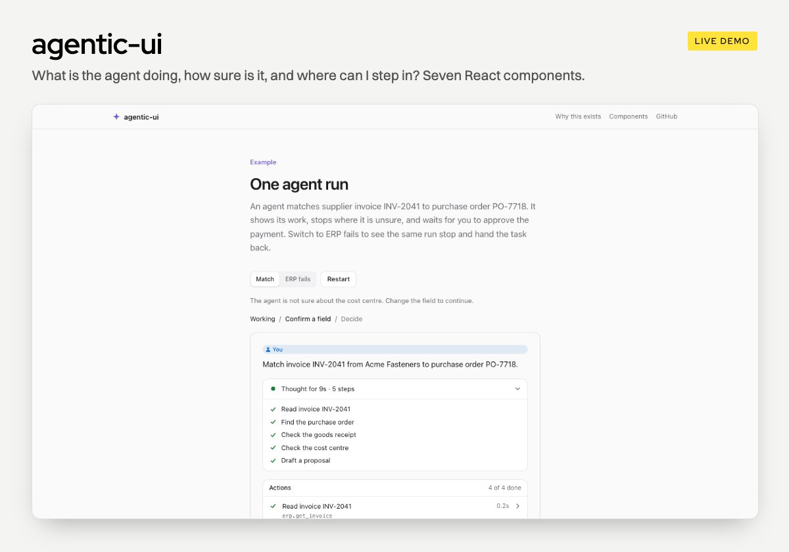
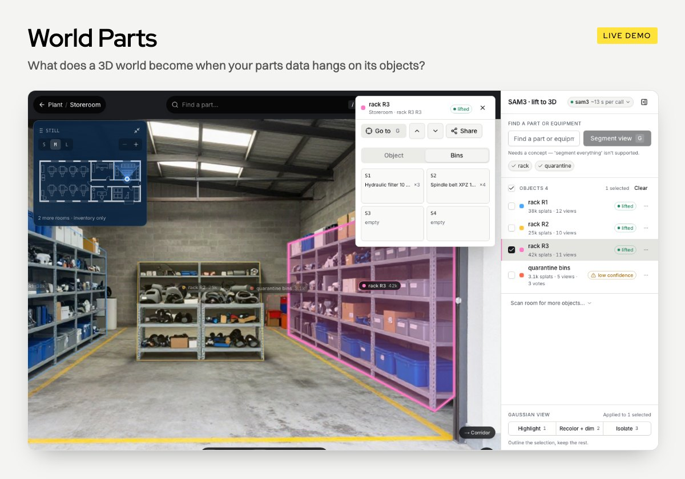
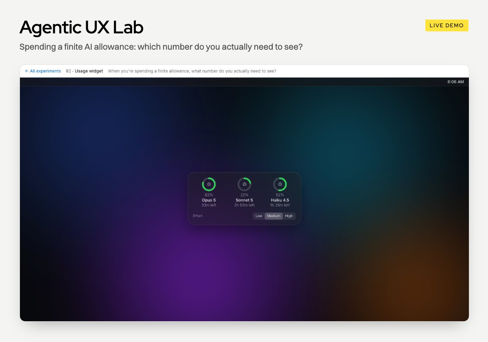
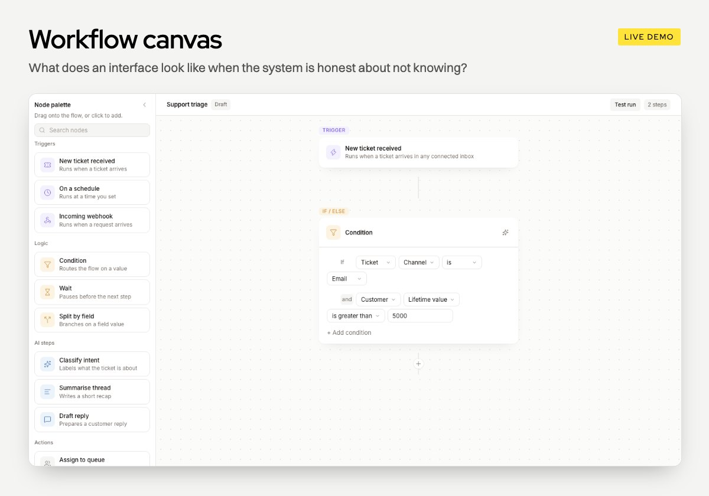
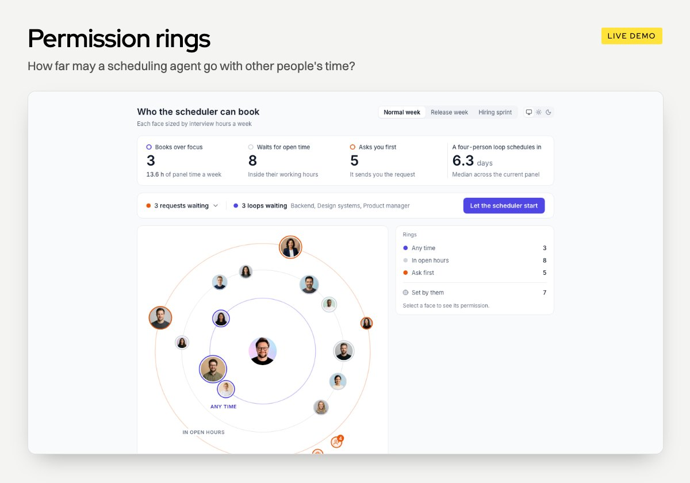
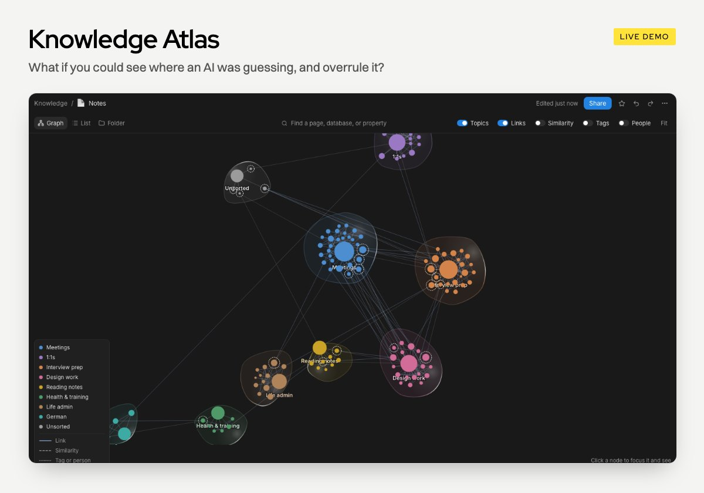

<picture>
  <source media="(prefers-color-scheme: dark)" srcset="assets/banner-dark.svg">
  
</picture>

I design and build interfaces for software that acts on its own: an AI agent does part of the work, and a person stays in charge.
14 years on complex systems: ERP, B2B SaaS, AI workflows. When a question is about latency, autonomy or trust, a static mock can't answer it, so I build the answer.

### Selected work

<table>
  <tr>
    <td width="50%" valign="top">
      
       <a href="https://github.com/sergushkincom/agentic-ui"><b>agentic-ui</b></a> · <a href="https://agentic-ui-docs.vercel.app">docs</a>
    </td>
    <td width="50%" valign="top">
      
       <a href="https://github.com/sergushkincom/world-parts"><b>World Parts</b></a> · <a href="https://world-parts.vercel.app">live</a>
    </td>
  </tr>
  <tr>
    <td width="50%" valign="top">
      
       <a href="https://github.com/sergushkincom/agentic-ux-lab"><b>Agentic UX Lab</b></a> · <a href="https://agentic-ux-lab.vercel.app">live</a>
    </td>
    <td width="50%" valign="top">
      
       <a href="https://github.com/sergushkincom/workflow-canvas"><b>Workflow canvas</b></a> · <a href="https://denys-workflow-canvas.vercel.app/experiments/workflow-canvas">live</a>
    </td>
  </tr>
  <tr>
    <td width="50%" valign="top">
      
       <a href="https://github.com/sergushkincom/permission-rings"><b>Permission rings</b></a> · <a href="https://permission-rings.vercel.app">live</a>
    </td>
    <td width="50%" valign="top">
      
       <a href="https://github.com/sergushkincom/knowledge-atlas"><b>Knowledge Atlas</b></a> · <a href="https://denys-knowledge-atlas.vercel.app">live</a>
    </td>
  </tr>
</table>

### Career, briefly

- **Xentral**: led UX for the AI-powered workflow builder; the agentic features are now a core part of sales demos.
- **Filemail**: trial-to-paid conversion from 40% to 53%; a CMS component library that cut page ship time 10×.
- **Gelato**: led 6 designers across 15 countries; mobile redesign with a 20%+ conversion uplift.
- **Microsoft**: started on Dynamics AX (Finance, Logistics, Manufacturing).

[sergushkin.com](https://sergushkin.com) · [LinkedIn](https://linkedin.com/in/sergushkincom) · [X](https://x.com/sergushkincom) · [Dribbble](https://dribbble.com/sergushkincom) · [Behance](https://behance.net/sergushkincom)
