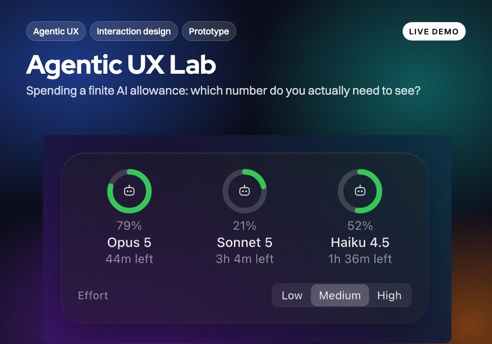
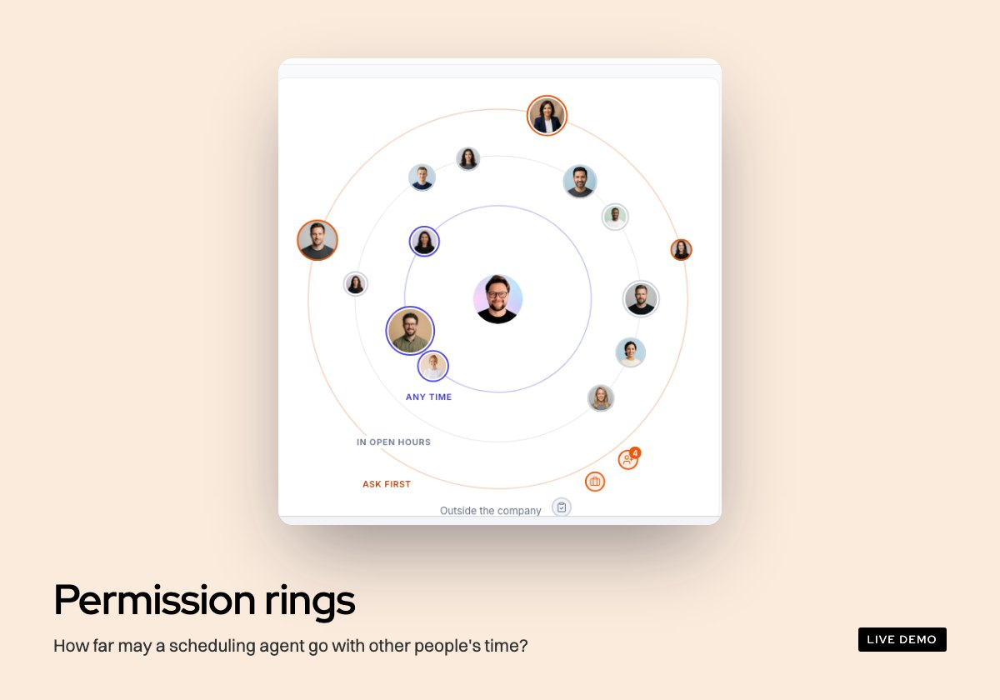

<!-- Banner pixel glints are an original SVG animation, inspired by pixelfx (MIT) by Patch and Hugo Duprez: https://github.com/patch-gg/pixelfx -->
<a href="https://sergushkin.com">
<picture>
  <source media="(prefers-color-scheme: dark)" srcset="assets/banner-dark.svg">
  
</picture>
</a>

I design and build interfaces for software that acts on its own: an AI agent does part of the work, and a person stays in charge.
14 years on complex systems: ERP, B2B SaaS, AI workflows. When a question is about latency, autonomy or trust, a static mock can't answer it, so I build the answer.

### Selected work

<table>
  <tr>
    <td width="50%" valign="top">
      
       <a href="https://github.com/sergushkincom/agentic-ui"><b>agentic-ui</b></a> · <a href="https://agentic-ui-docs.vercel.app">docs</a>
    </td>
    <td width="50%" valign="top">
      
       <a href="https://github.com/sergushkincom/world-parts"><b>World Parts</b></a> · <a href="https://world-parts.vercel.app">live</a>
    </td>
  </tr>
  <tr>
    <td width="50%" valign="top">
      
       <a href="https://github.com/sergushkincom/agentic-ux-lab"><b>Agentic UX Lab</b></a> · <a href="https://agentic-ux-lab.vercel.app">live</a>
    </td>
    <td width="50%" valign="top">
      
       <a href="https://github.com/sergushkincom/workflow-canvas"><b>Workflow canvas</b></a> · <a href="https://denys-workflow-canvas.vercel.app/experiments/workflow-canvas">live</a>
    </td>
  </tr>
  <tr>
    <td width="50%" valign="top">
      
       <a href="https://github.com/sergushkincom/permission-rings"><b>Permission rings</b></a> · <a href="https://permission-rings.vercel.app">live</a>
    </td>
    <td width="50%" valign="top">
      
       <a href="https://github.com/sergushkincom/knowledge-atlas"><b>Knowledge Atlas</b></a> · <a href="https://denys-knowledge-atlas.vercel.app">live</a>
    </td>
  </tr>
</table>

### Building in the open

| Project | The question it answers | |
|---|---|---|
| [Funding radar](https://github.com/sergushkincom/funding-radar) | Which Munich-area startups have fresh money, an open role, and a reason to talk now? | [Live demo →](https://funding-radar-two.vercel.app) |
| [Grocery first order](https://github.com/sergushkincom/grocery-first-order-prototype) | What if a new customer saw the deal before building the cart? | [Live demo →](https://grocery-first-order-prototype.vercel.app) |
| [Keyword Tracker](https://github.com/sergushkincom/keyword-tracker) | What if the rank table is the chart? | [Live demo →](https://denys-keyword-tracker.vercel.app) |
| [Design engineering shelf](https://github.com/sergushkincom/design-engineering-shelf) | Which books, courses and people actually help a designer who builds? | [Read the shelf →](https://github.com/sergushkincom/design-engineering-shelf#readme) |
| [DX Grid Inspector](https://github.com/JennHull-builds/dx-grid-inspector) (contribution) | Can a colour field refuse a value the browser can't read? | [Open PR →](https://github.com/JennHull-builds/dx-grid-inspector/pull/7) |

### How I work with AI agents

In my prototypes a coding agent writes the first version and most of the fixes. I review each round in the browser, at 375 px too, and keep a log: what I asked, what the agent got wrong, what I decided myself, and the commit for each.

- [World Parts, round 2](https://github.com/sergushkincom/world-parts/blob/main/AGENT_LOG.md#round-2--plant-overview-search-room-transition--2026-11-06): the hash router crashed when you clicked a room, a supplier's real brand name was in the data, and the plan scrolled sideways at 375 px. Each found in the browser, each fixed.
- [Grocery first order](https://github.com/sergushkincom/grocery-first-order-prototype/blob/main/AGENT_LOG.md): 14 rounds, each one marked *agent mistake*, *my decision* or *by hand*. In one the agent filled the cart with six items without asking; now it suggests and the customer confirms. If it touches money, a person confirms.
- [Rules I'd give the agent up front next time](https://github.com/sergushkincom/grocery-first-order-prototype/blob/main/AGENT_LOG.md#rules-id-give-the-agent-up-front-next-time): business values only from config, never add to the cart without confirmation, check every change in the browser.

### Career, briefly

- **Xentral**: led UX for the AI-powered workflow builder; the agentic features are now a core part of sales demos.
- **Filemail**: trial-to-paid conversion from 40% to 53%; a CMS component library that cut page ship time 10×.
- **Gelato**: led 6 designers across 15 countries; mobile redesign with a 20%+ conversion uplift.
- **Microsoft**: started on Dynamics AX (Finance, Logistics, Manufacturing).

[sergushkin.com](https://sergushkin.com) · [LinkedIn](https://linkedin.com/in/sergushkincom) · [X](https://x.com/sergushkincom) · [Dribbble](https://dribbble.com/sergushkincom) · [Behance](https://behance.net/sergushkincom)
